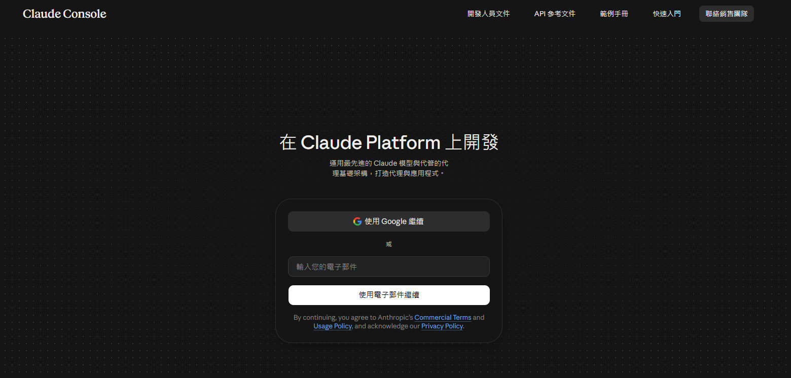
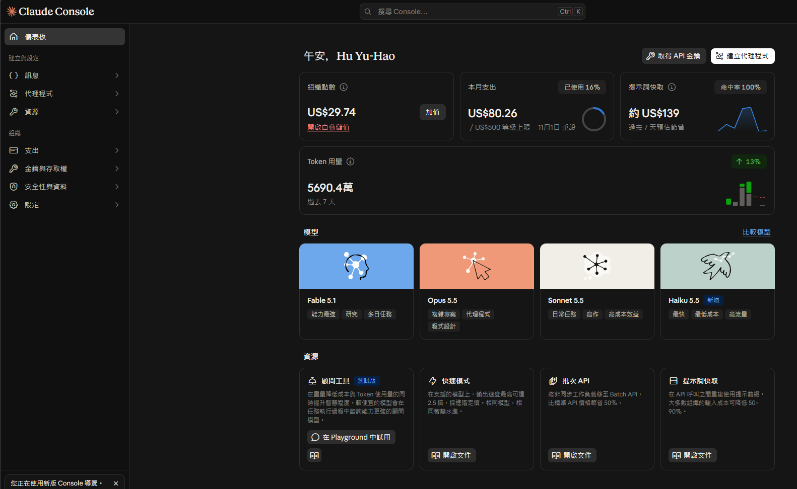
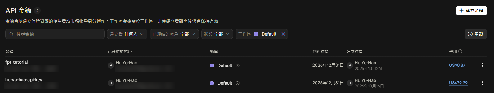
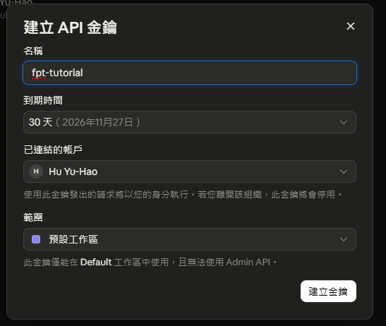
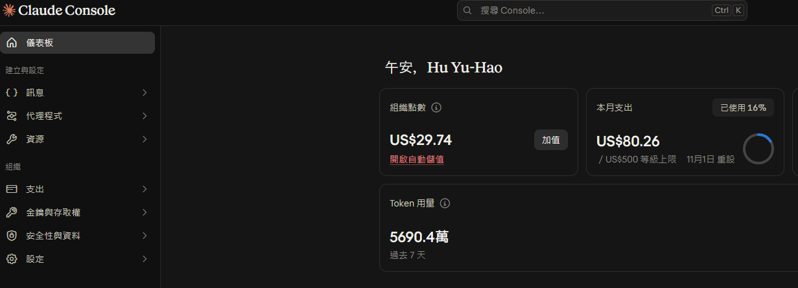
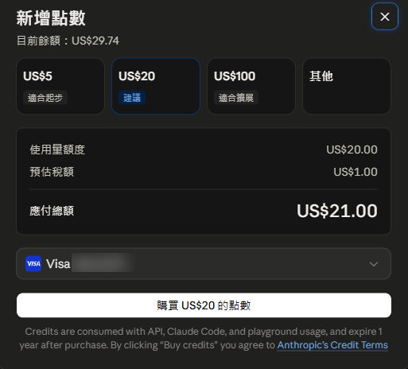
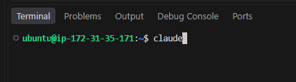
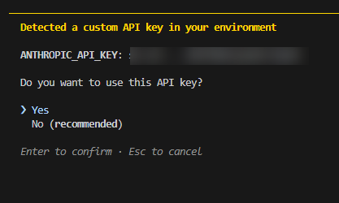
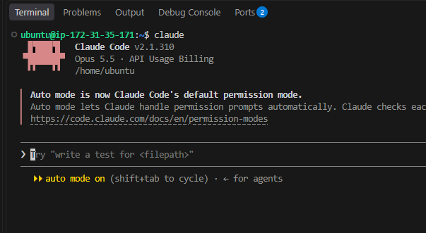

# Claude API 金鑰申請與使用教學

這份教學分成兩部分：

1. [在 Claude Console 建立 API 金鑰並儲值](#一建立-api-金鑰並儲值)
2. [在 Terminal 套用 API 金鑰使用 Claude Code](#二claude-套用-api-key-教學)

---

## 一、建立 API 金鑰並儲值

### 步驟 1：登入 Claude Console

前往 <https://platform.claude.com/login>，使用 Google 帳號或電子郵件登入。



### 步驟 2：進入「金鑰與存取權」

登入之後，點選左側選單的 **金鑰與存取權**。



### 步驟 3：建立金鑰

點選右上角的 **建立金鑰**，接著選 **使用 API 金鑰繼續**。



### 步驟 4：設定名稱與到期時間

輸入金鑰 **名稱** 以及 **到期時間**，然後點 **建立金鑰**。

> ⚠️ **重要：** 建立後畫面只會顯示一次完整的金鑰，請馬上複製並存在安全的地方。



### 步驟 5：回到首頁加值

回到首頁，點選「組織點數」旁的 **加值**。



### 步驟 6：選擇儲值金額

選擇要儲值的金額（US$5 / US$20 / US$100 / 其他），確認後購買點數。



---

## 二、Claude 套用 API key 教學

### 步驟 1：把 API key 加進 `~/.bashrc`

在 `~/.bashrc` 檔案最後加上這一行（換成你自己的金鑰）：

```bash
export ANTHROPIC_API_KEY="sk-ant-xxxxxxxx"
```

### 步驟 2：重新載入設定

在 terminal 執行：

```bash
source ~/.bashrc
```

### 步驟 3：啟動 Claude

接下來就可以直接在 terminal 輸入 `claude` 開始使用。



### 步驟 4：確認使用 API 金鑰

Claude 會說偵測到環境中有 `ANTHROPIC_API_KEY` 可以使用，選擇 **Yes** 後按 Enter。



### 步驟 5：開始使用 🎉

看到下面的畫面就代表設定完成，可以開始使用了！



---

> 🔒 **安全提醒：** 不要把 API 金鑰上傳到 GitHub 或分享給別人。如果金鑰外洩，請立刻到 Claude Console 刪除該金鑰並重新建立。
